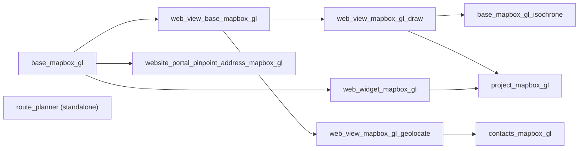

# Odoo Mapbox GL JS Integration

A suite of Odoo 19.0 addons that brings interactive Mapbox GL JS maps to Odoo — a reusable map view framework (GeoJSON shapes and lat/lng coordinates), a GeoJSON drawing widget for form fields, a reachable-area (isochrone) building block, and the application modules that consume them: Contacts, Project/Task, portal address pinpointing, and a standalone Route Planner app.

All Mapbox JS libraries (Mapbox GL JS v3.33.0, Mapbox GL Draw v1.5.2, Turf.js v7.4.0, Mapbox Search Box SDK v1.6.0) are loaded from their official CDNs at pinned versions — no local bundling or separate installation required.

---

## What's Included

| Capability | Module |
|---|---|
| Configuration & shared library | `base_mapbox_gl` |
| Reachable-area (isochrone) mixin | `base_mapbox_gl_isochrone` |
| Map view infrastructure | `web_view_base_mapbox_gl` |
| GeoJSON shape map view | `web_view_mapbox_gl_draw` |
| Lat/lng coordinate map view | `web_view_mapbox_gl_geolocate` |
| GeoJSON drawing widget for form fields | `web_widget_mapbox_gl` |
| Contacts map | `contacts_mapbox_gl` |
| Project & Task map views + site drawing | `project_mapbox_gl` |
| Portal address pinpointing | `website_portal_pinpoint_address_mapbox_gl` |
| Multi-stop route planning (no map yet — see [Roadmap](#roadmap)) | `route_planner` |

---

## Architecture

The suite is organized into layers. Each layer builds on the one below — you install only what you need. `route_planner` is currently standalone and has no Mapbox dependency.

### Layer 1 — Foundation

**`base_mapbox_gl`** is the dependency of every other Mapbox module. It loads the Mapbox GL JS library from Mapbox's CDN at a pinned version, stores the access token and default settings in General Settings, and provides shared UI components (geocoding search, style switcher) that any module can use.

### Layer 2 — View Framework & Widget

**`web_view_base_mapbox_gl`** provides the full MVC stack for map views: controller, model, renderer, and sidebar. It handles record-map synchronization, hover popups, grouping, multi-selection (box-zoom and Shift+Click), pager, and action menus. All map view modules extend this base.

**`web_widget_mapbox_gl`** is independent of the view framework — it provides a form field widget for drawing GeoJSON directly inside a form view, with its own toolbar and save flow.

### Layer 3 — View Types

**`web_view_mapbox_gl_draw`** and **`web_view_mapbox_gl_geolocate`** extend the base view framework to render GeoJSON geometry and lat/lng coordinates respectively.

### Layer 4 — Technical Extensions

**`base_mapbox_gl_isochrone`** reuses the GeoJSON storage from `web_view_mapbox_gl_draw` to let any model compute and display a "reachable within N minutes/meters" zone. It ships no standalone UI — a consuming module (not yet part of this repository) inherits the mixin.

### Layer 5 — Applications

Application modules consume the framework to deliver specific functionality. They never re-implement map rendering or library loading.

---

## Modules

### Foundation

**[base_mapbox_gl](base_mapbox_gl/README.md)** `19.0.1.1.0`

Core configuration module. Adds a Mapbox GL JS section to General Settings for the access token and default display options. Loads Mapbox GL JS from Mapbox's CDN at a pinned version with a dynamic asset loader and error handling. Provides a shared map core (styles, language switching, geocoding, display controls), a reusable `BaseMapboxGlComponent`/`MapboxGlMixin` for building new map views or widgets, a Mapbox Search component for address lookup, and 10 built-in map styles.

**[web_view_base_mapbox_gl](web_view_base_mapbox_gl/README.md)** `19.0.1.0.0`

Foundation for all Mapbox map views — registers the `mapbox_gl` view type alongside form, list, and kanban. Provides:

- Full MVC architecture — controller, model, renderer, and record sidebar
- Record ↔ map synchronization and hover popups with configurable field display
- Grouping support with collapsible sidebar sections
- Batch multi-selection via box-zoom, Shift+Click, checkboxes, and an action menu (export, delete, archive)
- Pager and search-bar integration (filters, favourites, group by)
- Automatic bounds fitting and debounced rendering to keep the UI responsive on large datasets

This is a technical dependency with no standalone UI — install `web_view_mapbox_gl_draw` or `web_view_mapbox_gl_geolocate` to display maps.

**[web_widget_mapbox_gl](web_widget_mapbox_gl/README.md)** `19.0.1.0.0`

Form field widget (`mapbox_gl_draw_geojson`) for drawing and editing GeoJSON geometries embedded directly in form views. Features:

- Draw points, lines, and polygons; circle tool (click center → click radius)
- Polygon cut to split shapes (Turf.js `difference`)
- Edit mode (drag vertices/shapes, delete) and a readonly display mode
- Explicit Save button — changes commit to the record only on Save, with unsaved changes highlighted
- Automatic area calculation (Turf.js geodesic) saved to a configured field
- GeoJSON file import/export, geocoding search, and mid-edit style switching
- Lazy-loaded assets (Mapbox GL Draw, Turf.js) and cleanup on unmount

### View Types

**[web_view_mapbox_gl_draw](web_view_mapbox_gl_draw/README.md)** `19.0.1.0.0`

Provides the `mapbox_gl_draw` view type for records that store GeoJSON geometry. Features:

- Renders all standard GeoJSON types (Point, LineString, Polygon, Multi*, GeometryCollection) with separate fill/stroke/point layers and default/hover/selected states
- Automatic Turf.js measurements: area (m²/ha/km²) and perimeter for polygons, length for lines, vertex counts, coordinates for points — units adapt to feature size
- Per-feature color coding with automatically darkened stroke borders
- `SearchableJson` field type with PostgreSQL JSONB operators (`json_eq`, `json_ne`, `json_contains`, `json_not_contains`), optimized via the domain optimizer
- Sidebar with title, description, measurements, and an Open Record button
- Auto-fit bounds with animated transitions
- Ships an example module (`example/`) demonstrating a full integration with a GeoJSON upload wizard

**[web_view_mapbox_gl_geolocate](web_view_mapbox_gl_geolocate/README.md)** `19.0.1.0.1`

Provides the `mapbox_gl_geolocate` view type for records with separate latitude/longitude fields. Features:

- Smart overlap handling: markers sharing coordinates (within 0.000001°) are spread in a ~10 m circle with dotted connection lines, visible from zoom 17+
- Color-coded markers (color index, named color, or hex)
- Optional clustering (count-colored bubbles, click to expand) or heatmap (zoom 0–9, mutually exclusive with clustering)
- Box-zoom and Shift+Click multi-selection
- Batch processing (50k features/batch), throttled mouse events, and debounced map operations for performance on large datasets

### Technical Extensions

**[base_mapbox_gl_isochrone](base_mapbox_gl_isochrone/README.md)** `19.0.1.0.1`

Reusable "reachable within N minutes" mixin backed by the Mapbox Isochrone API. Adds an abstract `base.mapbox.isochrone` model that any model with coordinates can inherit. Features:

- Three travel profiles (driving, walking, cycling); zones defined by time (1–60 min) or distance (1–100,000 m)
- Manual "Recompute" action only — no automatic recompute or cron, since the Isochrone API is billed per request and rate-limited
- Passive staleness indicator when coordinates or settings change, without firing an API call
- Map field showing the stored zone, fitted to it, with total area and farthest reach in metric/imperial units
- Switching between time and distance clears the stale zone with a warning
- Recompute is gated by edit access and capped at 10 records per batch

This is a technical dependency with no standalone UI — a consuming module must inherit the mixin, set `_isochrone_coordinate_fields`, and expose the recompute action in its own views (no such consuming module exists in this repository yet; see [Roadmap](#roadmap)).

### Applications

**[contacts_mapbox_gl](contacts_mapbox_gl/README.md)** `19.0.1.0.0`

Adds a `mapbox_gl_geolocate` map view directly inside Contacts. Features:

- Map tab alongside List, Kanban, and Form
- Marker clustering and per-contact marker color (color picker field on the partner form)
- Sidebar with a scrollable contact list synced to the map
- Popup cards showing contact name and address on hover
- Scheduled cron (every 12 hours) that auto-geocodes contacts with an address but no coordinates yet

**[project_mapbox_gl](project_mapbox_gl/README.md)** `19.0.1.0.1`

Extends Project with interactive Mapbox map views and GeoJSON drawing for Projects and Tasks. Features:

- Map view for Projects, auto-injected into standard Project window actions on install (and removed cleanly on uninstall)
- Map view for Tasks, with the parent project's geometry rendered as a context overlay and a link back to the project
- Site tab on the Project form — full drawing canvas (polygons, lines, points) with automatic area calculation, a color picker, and an HTML notes field
- Site tab on the Task form — same drawing canvas, plus a read-only display of the parent project's area

**[website_portal_pinpoint_address_mapbox_gl](website_portal_pinpoint_address_mapbox_gl/README.md)** `19.0.1.0.0`

Adds an interactive map to the portal "My Address" form. Features:

- Click-to-pin location selection embedded in the standard address form
- Pre-fills the marker from any existing partner coordinates
- Saves latitude/longitude to the partner record automatically on form submission

### Standalone

**[route_planner](route_planner/README.md)** `19.0.1.2.1`

Top-level application for multi-stop route planning — no Mapbox dependency. Provides the Route Planner menu, route/stop models, lifecycle, fleet integration, and the TSP heuristics (nearest-neighbor + 2-opt) intended for a future Mapbox-based optimization layer. Features:

- Five-state route lifecycle: Draft → Confirmed → In Progress → Done / Cancelled
- Configurable route types with optional enforcement of vehicle, driver, and departure date at confirmation, plus a default service duration per stop
- Vehicle/driver assignment (selecting a vehicle auto-fills the driver), per-stop status and notes, calendar view, and automatic sequence numbering
- Role-based access (User sees own routes; Administrator sees all; only Draft routes can be deleted)
- Chatter/activities on every route, and generic origin tracking so other apps can create a route via `_create_from_stops()`
- Route Stops menu for browsing all stops across all routes independently

---

## Roadmap

The following modules are referenced by `route_planner` and `base_mapbox_gl_isochrone` as the intended consumers of those building blocks, but are **not yet part of this repository**:

- `route_planner_mapbox_gl` — Mapbox map visualization and API-based route calculation on top of `route_planner`
- `contacts_route_planner_mapbox_gl` — create a route from contacts selected in the Contacts list/map view
- `delivery_route_planner_mapbox_gl` — generate delivery routes from Inventory batch transfers
- `website_route_planner_mapbox_gl` / `website_delivery_route_planner_mapbox_gl` — mobile-friendly driver portal
- `fieldservice_dispatch_mapbox_gl` — matches field service orders to technicians using `base_mapbox_gl_isochrone`

---

## Getting Started

### 1. Get an access token

Sign up at [mapbox.com](https://www.mapbox.com/) and copy your **public access token** — it starts with `pk.`. Never use a secret token in a frontend application.

### 2. Configure Odoo

Install `base_mapbox_gl`, then go to **Settings → General Settings → Integrations → Mapbox GL JS** and paste your token.

### 3. Install the modules you need

| Goal | Install |
|---|---|
| Display GeoJSON shapes on a map view | `web_view_mapbox_gl_draw` |
| Display records by lat/lng on a map view | `web_view_mapbox_gl_geolocate` |
| Draw and edit GeoJSON shapes in a form field | `web_widget_mapbox_gl` |
| Compute a "reachable within N minutes" zone for a record | `base_mapbox_gl_isochrone` |
| Show contacts on a map | `contacts_mapbox_gl` |
| Add map views and GeoJSON drawing to Projects and Tasks | `project_mapbox_gl` |
| Let portal users pinpoint their address on a map | `website_portal_pinpoint_address_mapbox_gl` |
| Plan multi-stop routes (fleet, lifecycle — no map yet) | `route_planner` |

Dependencies are resolved automatically — installing any module will install its prerequisites.

---

## Requirements

- **Odoo** 19.0
- **Browser** — any modern browser with WebGL support
- **Mapbox access token** — public token (`pk.`) from [account.mapbox.com](https://account.mapbox.com/)

---

## Security

- Use a **public token** (`pk.`) only — never commit or expose a secret token
- Add **URL restrictions** to your Mapbox token in the Mapbox dashboard for production deployments
- The token is stored in `ir.config_parameter` and is only delivered to authenticated Odoo users
- Map tiles are rendered client-side; only coordinates are sent to Mapbox servers

---

## License

[LGPL-3](https://www.gnu.org/licenses/lgpl-3.0) © Yopi Angi (Mithnusa)

---

## Author

**Yopi Angi**
[github.com/mithnusa](https://github.com/mithnusa) · yopiangi@gmail.com

If you encounter a bug or want to integrate Mapbox GL with another Odoo module, open an issue or start a discussion.
